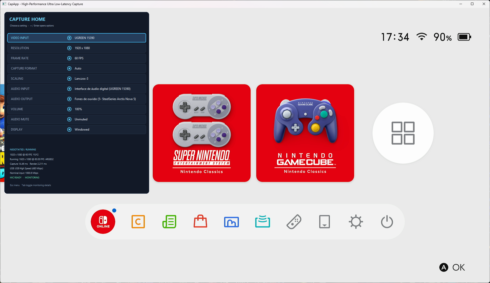
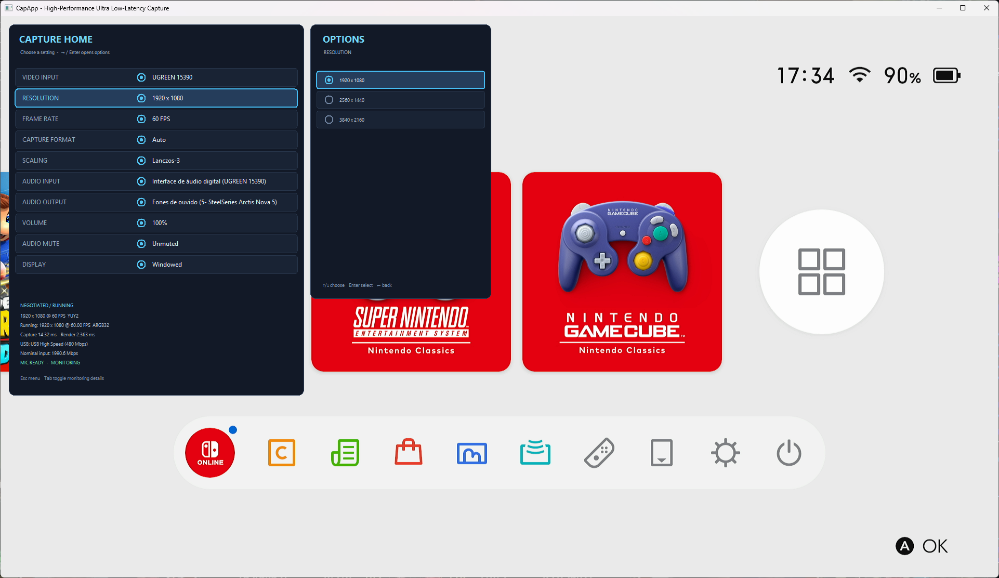

# CapApp

**A low-latency Windows preview for capture cards and cameras.**

CapApp previews live video in a resizable or fullscreen window, with capture controls, audio monitoring, and live device diagnostics.

## Screenshots



*CapApp running with a Nintendo Switch connected, showing the home menu and live capture statistics.*



*The same capture view, demonstrating the available submenu options.*

## Features

- Previews cameras and capture cards and reports the mode negotiated with the device.
- Lets you change the capture device, resolution, frame-rate target, and capture format while the app is running.
- Preserves the video aspect ratio when resizing; choose **None** (nearest-neighbor), **Smooth**, or **Lanczos-3** scaling.
- Fits a window to the running frame dimensions with **Native size**, scaling down proportionally when needed.
- Captures audio from a selectable input and monitors it through a selectable output, with software volume and mute controls.
- Shows negotiated source settings separately from the running output size, measured FPS, frame timings, and USB information.
- Remembers your settings between launches.

## Controls

The home menu opens on startup. Use **Up/Down** to focus a setting and **Right** or **Enter** to open its choices. Use **Up/Down** to browse choices and **Enter** to apply one; **Left** returns from the choices panel. You can also click settings and choices.

| Key | Action |
| --- | --- |
| `Esc` | Toggle the settings menu |
| `Tab` | Show/hide negotiated and running capture details; when the menu is closed, show details without the menu |
| `C` | Cycle video input |
| `R` | Cycle target resolution |
| `P` | Cycle target frame rate |
| `K` | Cycle available capture formats |
| `L` | Cycle scaling: None, Smooth, Lanczos-3 |
| `I` | Cycle audio input |
| `+` / `-` | Adjust audio monitor volume |
| `M` | Mute/unmute audio monitoring |
| `S` | Save a frame snapshot |
| `F11` | Toggle fullscreen/windowed mode |
| `Space` | Pause/resume the preview |

The **Display** setting includes Windowed, Fullscreen, and Native size (fit screen). Audio output selection and other configurable options are in the home menu. Settings are stored at `%APPDATA%\CapApp\settings.ini` and restored on launch; explicit command-line values take precedence for supported options.

## Requirements

- Windows
- Visual Studio with the C++ desktop development tools and Windows SDK
- CMake 3.25 or newer
- Ninja

## Build

Open a Visual Studio Developer PowerShell (or another shell configured for MSVC) in the repository directory:

```powershell
cmake --preset ninja-release
cmake --build --preset ninja-release
```

The executable is `build\src\capapp.exe`.

## Quick start

First, list the capture devices CapApp can see:

```powershell
build\src\capapp.exe --list-devices
```

Start the preview:

```powershell
build\src\capapp.exe
```

Or choose a device and target mode:

```powershell
build\src\capapp.exe --device 1 --resolution 1080p --fps 60
```

The target resolution and FPS are requests; the device may negotiate a different source mode. Use **Tab** to inspect the negotiated and running values.

## Command-line options

| Option | Description |
| --- | --- |
| `--list-devices`, `-l` | List detected capture devices and their advertised formats |
| `--device`, `-d <index or name>` | Select a capture device |
| `--resolution`, `-r <mode>` | Request `1080p`, `1440p`, `4k`, or explicit dimensions such as `2560x1440` |
| `--fps <rate>` | Request a target frame rate |
| `--fullscreen`, `-f` | Start fullscreen |
| `--no-hud` | Start with the settings/telemetry overlay hidden |
| `--benchmark`, `-b` | Run the built-in latency benchmark |
| `--help`, `-h` | Show command-line help |

## Tests

Build and run the test suite with:

```powershell
cmake --build --preset ninja-release
ctest --preset ninja-release
```

## Project layout

| Path | Contents |
| --- | --- |
| `src/` | Application, capture, rendering, audio, and synchronization |
| `include/capapp/` | Public headers and shared types |
| `tests/` | Unit and integration tests |
| `shaders/` | Rendering shaders |
| `assets/` | Application resources |
| `docs/` | Technical documentation and screenshots |
